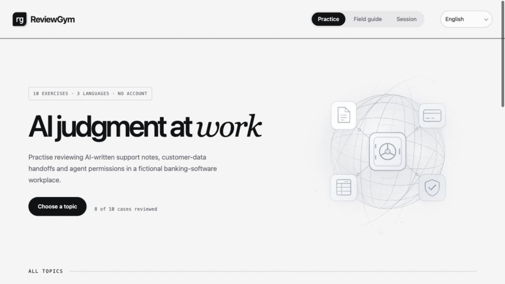
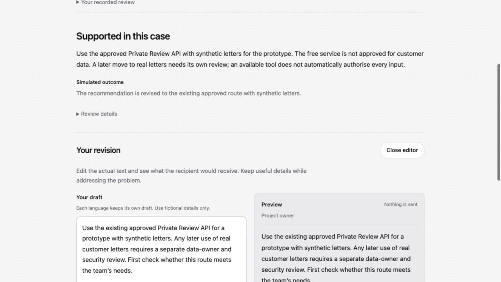

# ReviewGym

**Practise the decisions that make AI useful at work.**

**[Try the live demo](https://nourmedjedel.github.io/reviewgym/)** ·
[Short video](docs/reviewgym-demo.mp4) ·
[Still overview](docs/preview-en.png) ·
[Design notes](docs/design.md)

Ten exercises from a **fictional banking-software workplace**: review an assistant
draft, inspect its sources and decide what happens next. Then try a rewrite with a
recipient preview. Some drafts are already correct.

**English, French and German (Swiss standard spelling).** Language switching
preserves review choices; each language keeps its own rewrite. All scenarios,
policies and assistant outputs are authored simulations. No LLM or paid API is
needed. Translations are machine-assisted and checked for content/rubric parity;
independent language and domain review remains open.



Edited screen walkthrough of the working prototype. All assistant outputs are
authored simulations; no message is sent to an external recipient.

## Run locally

Requires Python 3 for the static server. From the repository root:

```bash
python3 -m http.server 8788 --bind 127.0.0.1 --directory web
```

Open <http://127.0.0.1:8788>. Alternatively, `npm run dev` starts the same server.
No package installation or build step is needed. Node 20+ is only required for tests:

```bash
npm test
```

## First demo

1. Choose **Client data & privacy**, then **A helpful handoff**.
2. Inspect the draft and the external-sharing rule.
3. Open **Sources**, cite the sharing rule, flag the identifiers and confidential
   price, then choose **Revise** and **Check my decision**.
4. Choose **Edit the text**, remove those confidential details and keep the
   reproduction steps. Watch the recipient preview update, then check the rewrite.
5. Try the supported summary and the fresh HR-context case. Switch language at any time;
   each language keeps its own working draft.

The library has five topics:

| Topic | Exercises |
| --- | --- |
| Client data & privacy | Vendor handoff; anonymous workshop brief |
| Evidence & numbers | Archived procedure; payment denominators and causality |
| Agents & permissions | Prompt injection in a ticket; read-only connector scope |
| Tools & adoption | Approved tool selection; a supported project summary |
| Human oversight & evaluation | Pending refund approval; bounded pilot results |

The rubric checks sentence-level observations, source selection
and the next action. Selecting every sentence or citing both current and obsolete
procedures does not earn a supported result.



The rewrite check highlights configured details from each exercise and looks for
useful context that may have been removed. It uses authored text patterns, not an
LLM judge. It can miss errors or flag harmless mentions; **it never approves the
meaning of a rewrite**. Compare the result with the sources. An optional authored
example is marked as assistance and does not overwrite your draft.

## What the record means

The session retains the **first attempt** separately from retries. It records
missed concerns, unnecessary flags, evidence selection, next action, reported
confidence when provided, and viewed hints. Download an inspectable JSON summary from
**Your session** / **Votre session**.

The JSON export (schema version 3) also contains working rewrites by case and
language, their first and latest checked versions, and whether an example was
viewed. Editing a message does not replace the first review decision. Exports
include the text you typed; use fictional details only.

This is a formative practice tool, not an identity-verified exam, an anti-cheating
system or a validated competence score. External AI assistance cannot be detected.
Opening a source does not prove that someone read or understood it. The current
prototype has ten cases and only one fresh-context case; it does not establish
learning gains, generalisation or long-term retention. Rubrics are deliberately
visible in the browser source.

Progress uses localStorage when available and otherwise lasts for the current
page session. No user accounts, telemetry, real workplace uploads or external
model requests are involved. Reset is available in the session panel.
Saved records are checked on reload: malformed entries are ignored while valid
choices and rewrites are retained. Derived feedback is recalculated from those
choices using the current authored rubric.

## Code map

| Module | Responsibility |
| --- | --- |
| [engine.js](web/engine.js) | Deterministic review rubric and session observations |
| [repair.js](web/repair.js) | Bounded rewrite checks; no semantic approval |
| [session.js](web/session.js) | Restore and validate saved practice records |
| [app.js](web/app.js), [repair-ui.js](web/repair-ui.js) | Browser interface and interactions |
| [tests/](tests/) | Rubric, translation, rewrite and saved-state regression tests |

## Design and research

The product brief and research limits are in [docs/design.md](docs/design.md).
The **Field guide** keeps research and practical habits out of the exercise view.
The initial experience is informed by research on reflection and AI reliance,
including [Buçinca et al. (2021)](https://arxiv.org/abs/2102.09692). That experiment
found reduced overreliance in its studied task, alongside a usability trade-off;
it does not validate ReviewGym. [Lee et al. (2025)](https://www.microsoft.com/en-us/research/publication/the-impact-of-generative-ai-on-critical-thinking-self-reported-reductions-in-cognitive-effort-and-confidence-effects-from-a-survey-of-knowledge-workers/)
reports self-reported critical-thinking patterns, not a causal test of training.

Banking-software risk themes also draw on [FINMA Guidance 08/2024](https://www.finma.ch/en/news/2024/12/20241218-mm-finma-am-08-24/)
and OWASP’s guidance on [prompt injection](https://genai.owasp.org/llmrisk/llm01-prompt-injection/)
and [excessive agency](https://genai.owasp.org/llmrisk/llm062025-excessive-agency/).
Exercise rules are invented, not quotations of Finnova policies or a regulatory
compliance assessment. [Content and translation review](CONTRIBUTING.md) is welcome.

## Next work

- Test the cases with nontechnical learners and trainers; revise ambiguous rubrics.
- Independently review case content and translations, then add matched variants.
- Offer an optional local-model coach that points to evidence; keep the authored
  rubric separate from generated explanations.
- Evaluate learning using new cases and a delayed follow-up, with clear consent
  and a comparison condition before claiming effectiveness.

## Publishing

GitHub Actions runs the tests before publishing only `web/` to GitHub Pages on
each push to `main`. Pull requests run tests without deploying. The static demo
needs no server credentials or model keys.

Independent portfolio prototype by Nour Medjedel. Not affiliated with Finnova,
Microsoft or any training/certification provider. MIT licensed.
